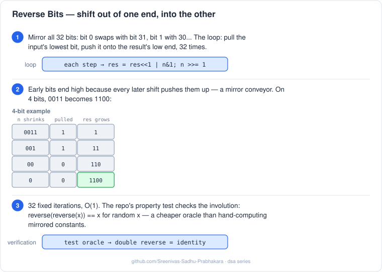

# Reverse Bits

> NeetCode 150 · Bit Manipulation · Blind 75 — shift the result left while feeding in the input's lowest bits: a 32-step conveyor belt. Go, stdlib only, tested.

## Problem

Mirror a 32-bit word — bit 0 to bit 31, bit 1 to bit 30, and so on.

## Approach

Treat the two words as a conveyor: each step shifts the output left (making room) and drops the input's lowest bit into it, while the input shifts right to expose the next. Thirty-two steps, no masks tables. The divide-and-conquer version — swap halves, then quarters, then pairs, in five masked operations — is what `math/bits.Reverse32` does and is worth recognizing; the tests use it as the oracle plus the involution property (reversing twice is the identity) over random words, a free second check that catches direction mistakes a single fixture can't.

**Complexity:** O(32) ≈ O(1); O(1) space.

## Visual walkthrough

Read the picture top to bottom — each numbered frame is one moment of the algorithm
running on this repo's test example.

## Run

    go test ./...   # verify
    go run .        # demo

---

Part of a 275-repo DSA series in Go — Striver's SDE Sheet (dsa-001–191) plus the NeetCode 150 / Blind 75 additions (dsa-192–275), stdlib only, every solution tested. Browse: [`dsa-*` repos](https://github.com/Sreenivas-Sadhu-Prabhakara?tab=repositories&q=dsa-&type=source).
